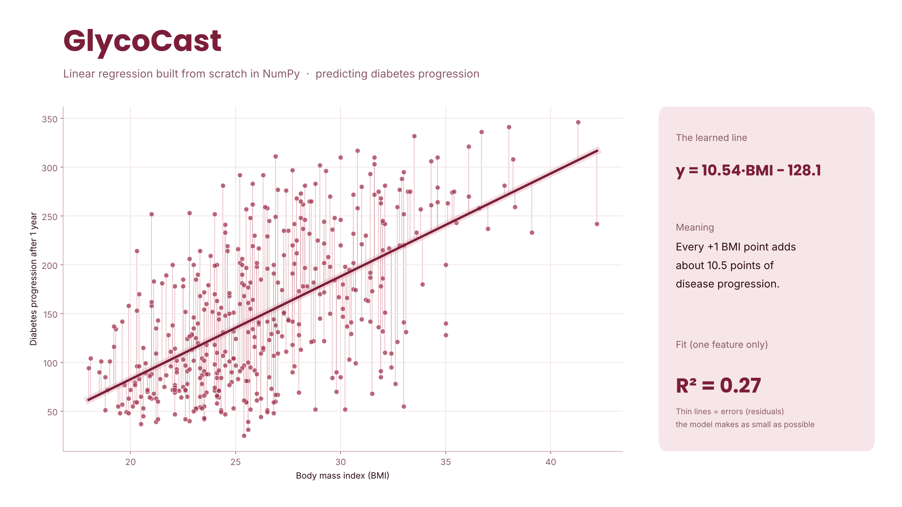
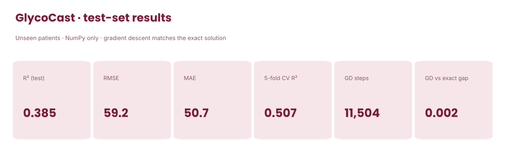
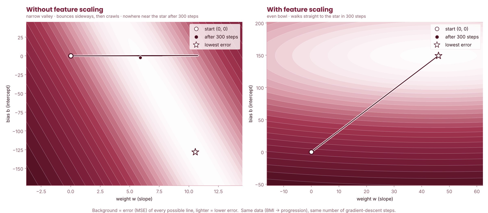
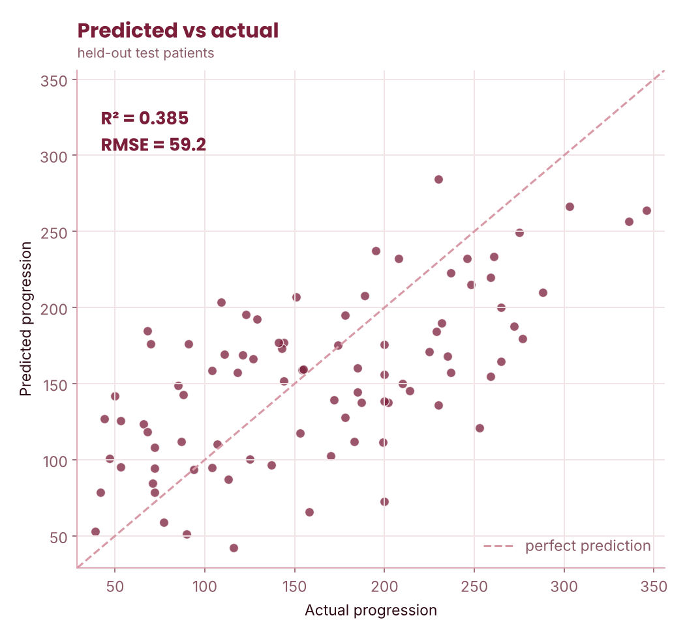
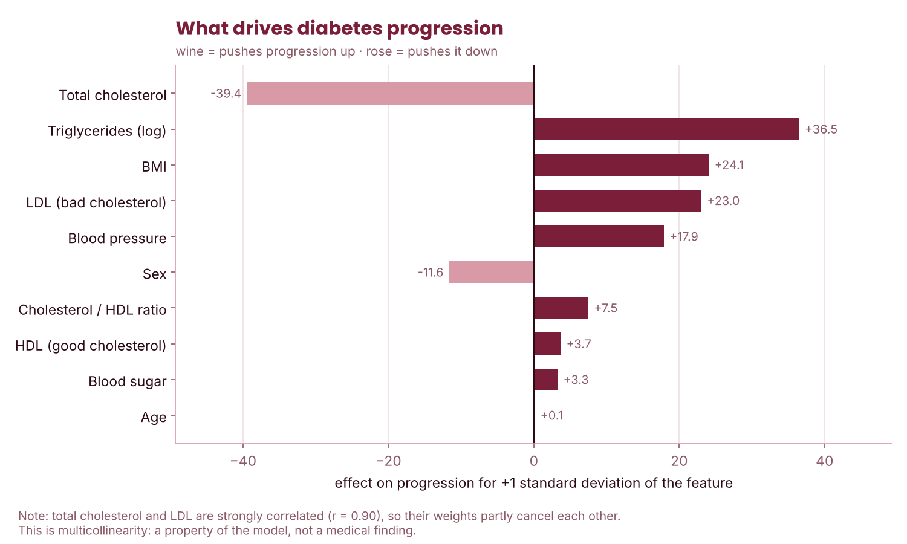
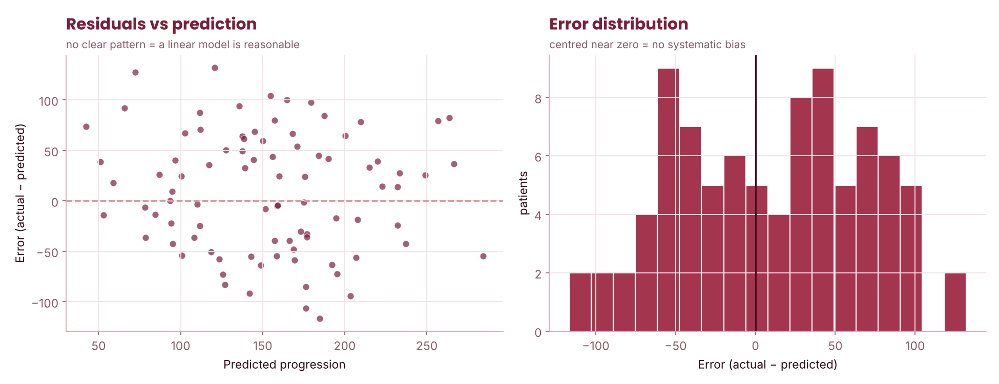
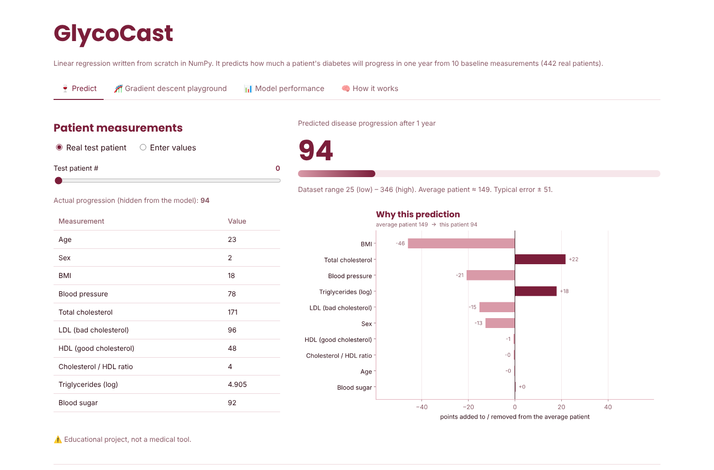
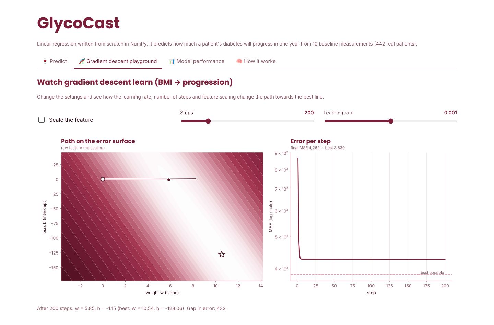

# GlycoCast: linear regression from scratch for diabetes progression



**Linear regression written in pure NumPy**, without the scikit-learn model. It predicts how much a patient's diabetes
will progress one year later from 10 baseline measurements: age, sex, BMI, blood pressure and six blood-serum tests.
Data: the Diabetes dataset (Efron et al., 2004, *Least Angle Regression*), 442 real patients.



## Highlights
- **Two solvers, both written by hand:** gradient descent and the exact normal equation. They agree to within 0.002.
- **Same result as scikit-learn:** R² 0.385 on the same split, and the weights match.
- **5-fold cross-validation** written from scratch: R² 0.507 ± 0.072.
- **Feature scaling, explained visually:** without scaling, gradient descent gets stuck in a narrow valley.
- **Explainable predictions:** the app shows how much each measurement adds to or removes from the prediction.
- **Interactive gradient descent playground:** change the learning rate, steps and scaling, and watch it converge or blow up.



## Results (88 unseen test patients)

| Metric | Value |
|---|---|
| R² (test) | 0.385 |
| R² (5-fold cross-validation) | 0.507 ± 0.072 |
| RMSE | 59.2 |
| MAE | 50.7 |
| RMSE of always guessing the average | 76.6 |

Diabetes progression is noisy and depends on much more than these 10 numbers, so R² of about 0.4–0.5 is the normal
ceiling for a linear model on this dataset. The model cuts the error by 23% compared with guessing the average.

| | |
|---|---|
|  |  |



## What is implemented from scratch (`glycocast/linreg.py`)
- Prediction `ŷ = Xw + b` and the mean squared error loss
- Hand-derived gradients `dL/dw = (2/n)·Xᵀ(ŷ − y)` and `dL/db = (2/n)·Σ(ŷ − y)`
- Gradient descent with a convergence check
- Normal equation `θ = (XᵀX + λI)⁻¹Xᵀy`, with optional Ridge (L2)
- Standard scaler, train/test split, K-fold cross-validation
- R², RMSE, MAE, MSE

## Web app (Python backend + website, deployed on Vercel)




- **Backend:** Python with FastAPI (`app.py`). It loads the trained weights, makes and explains predictions,
  runs gradient descent live for the playground, and draws every chart with matplotlib.
- **Frontend:** a website (`frontend/`) that sends your inputs to the API and shows the results.
- Both deploy together as one Vercel project, so the app never goes to sleep. See [DEPLOY.md](DEPLOY.md).

| Endpoint | What it does |
|---|---|
| `GET /api/info` | metrics, input ranges, learning-rate options |
| `POST /api/predict` | `{"patient": 3}` or `{"values": {"bmi": 30}}` → prediction + "why" chart |
| `POST /api/playground` | `{"scaled": true, "steps": 200, "lr": 0.05}` → gradient descent path + error chart |
| `GET /docs` | interactive API documentation (made by FastAPI) |

Live link: *add your Vercel link here*

## Run it
```bash
pip install -r requirements-train.txt          # everything, including scikit-learn for training
python train.py                                # trains, prints metrics, saves model + charts
python -m uvicorn app:app --reload             # web app at http://localhost:8000
```

## Project structure
```
glycocast/
├── glycocast/
│   ├── linreg.py      # the model, scaler, split, CV, metrics (core)
│   └── viz.py         # wine + white charts
├── train.py           # full pipeline
├── app.py             # FastAPI backend (the API + serves the website)
├── frontend/          # the website: index.html, style.css, app.js
├── models/            # saved weights + results.json
├── assets/            # charts and screenshots
├── requirements.txt         # what the web app needs (Vercel installs this)
└── requirements-train.txt   # + scikit-learn, for training
```

*Educational project, not a medical tool.*
